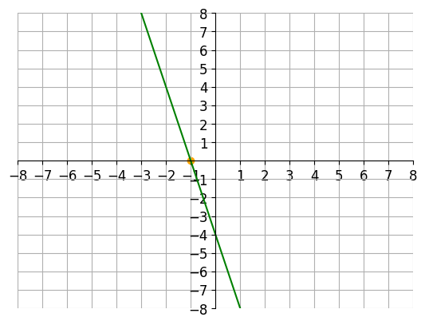

# AVP0961 — Single visual target

VisioMath:1168_A / DynaMath:109 · different type · Mathematical roles of graphical elements

[Left image in official archive](https://raw.githubusercontent.com/Nefefilibata/VisioMath/4a912153e110001da261917902e1d3cc163b7c6a/data/images.zip) · `images/1168_A.jpg`

## Shared or similar visual information

A straight diagonal-looking stroke.

## Evidence locations

- Left image: The solid line from the upper-left to the lower-right rectangle corner.
- Right image: The green descending line across the coordinate grid.

## Mathematical meanings

Left image: A diagonal connecting opposite vertices inside a quadrilateral. Right image: A sloping straight graph encoding a constant rate of change of output with input.

## Same mathematical meanings

no

## Rationales

The plotted line expresses how output changes across an input scale. The segment through a quadrilateral connects its opposite vertices as a geometric diagonal.

Only the selected target is annotated. AI visual-review draft; not independently double-annotated by humans.
