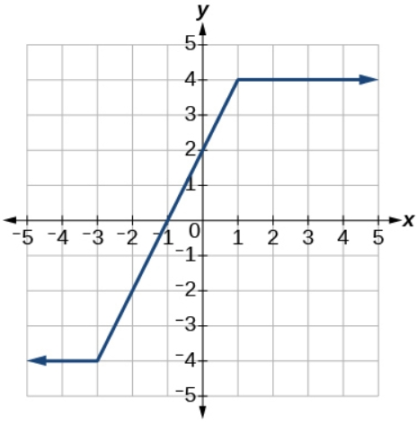

# AVP0962 — Single visual target

VisioMath:30_A / MathVerse:501 · same type · Mathematical roles of graphical elements

[Left image in official archive](https://raw.githubusercontent.com/Nefefilibata/VisioMath/4a912153e110001da261917902e1d3cc163b7c6a/data/images.zip) · `images/30_A.jpg`

## Shared or similar visual information

A horizontal part of a plotted graph.

## Evidence locations

- Left image: The flat top of the trapezoid-like graph above the x-axis.
- Right image: The upper horizontal blue ray at y=4.

## Mathematical meanings

Left image: A portion of the plotted trace with constant output over a horizontal input interval. Right image: A portion of the plotted trace with constant output over a horizontal input interval.

## Same mathematical meanings

yes

## Rationales

Both horizontal portions belong to the plotted trace itself. Their unchanging height shows that output stays constant across that portion of the horizontal input scale.

Only the selected target is annotated. AI visual-review draft; not independently double-annotated by humans.
