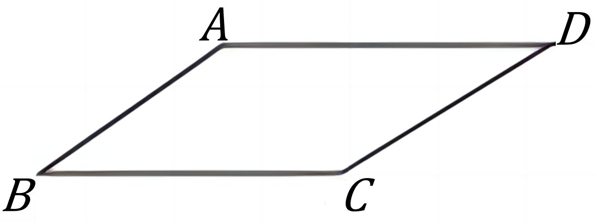

# AVP0972 — Single visual target

VisioMath:1114_A / DynaMath:49 · different type · Mathematical roles of graphical elements

[Left image in official archive](https://raw.githubusercontent.com/Nefefilibata/VisioMath/4a912153e110001da261917902e1d3cc163b7c6a/data/images.zip) · `images/1114_A.jpg`

## Shared or similar visual information

A straight horizontal segment.

## Evidence locations

- Left image: The horizontal segment at the top of the distance-versus-time trace.
- Right image: The horizontal side BC of the parallelogram.

## Mathematical meanings

Left image: A portion of the plotted trace with constant output over a horizontal input interval. Right image: A horizontal boundary side of a finite geometric polygon.

## Same mathematical meanings

no

## Rationales

The horizontal trace carries constant output over an input interval. The other stroke closes a finite polygon between its adjacent sides.

Only the selected target is annotated. AI visual-review draft; not independently double-annotated by humans.
