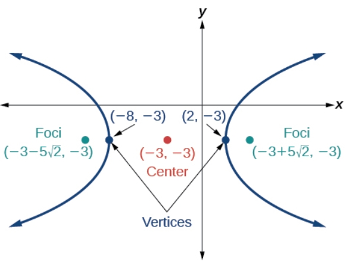

# AVP0981 — Single visual target

MathVerse:438 / VisioMath:57_A · different type · Mathematical roles of graphical elements

[Right image in official archive](https://raw.githubusercontent.com/Nefefilibata/VisioMath/4a912153e110001da261917902e1d3cc163b7c6a/data/images.zip) · `images/57_A.jpg`

## Shared or similar visual information

An arrowhead at the positive end of a coordinate axis.

## Evidence locations

- Left image: The upward arrowhead on the y-axis in the hyperbola diagram.
- Right image: The arrowhead at the right end of the horizontal x-axis.

## Mathematical meanings

Left image: The arrowhead orienting the positive direction of a coordinate axis. Right image: The arrowhead orienting the positive direction of a coordinate axis.

## Same mathematical meanings

yes

## Rationales

In both diagrams the arrowhead belongs to a coordinate axis and orients that reference scale. The curve or geometric figure plotted on the axes is a separate element.

Only the selected target is annotated. AI visual-review draft; not independently double-annotated by humans.
