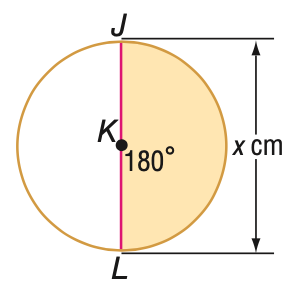

# AVP0983 — Single visual target

MathVista:250 / VisioMath:119_A · different type · Mathematical roles of graphical elements

[Right image in official archive](https://raw.githubusercontent.com/Nefefilibata/VisioMath/4a912153e110001da261917902e1d3cc163b7c6a/data/images.zip) · `images/119_A.jpg`

## Shared or similar visual information

An arrowhead attached to the end of a straight line.

## Evidence locations

- Left image: The upper arrowhead beside x cm to the right of the circle.
- Right image: The right-pointing arrowhead of the horizontal x-axis.

## Mathematical meanings

Left image: An arrowhead at one limit of a finite spatial dimension. Right image: The arrowhead orienting the positive direction of a coordinate axis.

## Same mathematical meanings

no

## Rationales

The coordinate arrow orients the axis used to read values. The dimension arrow identifies one limit of a finite geometric length, as shown by its opposite arrow and length label.

Only the selected target is annotated. AI visual-review draft; not independently double-annotated by humans.
