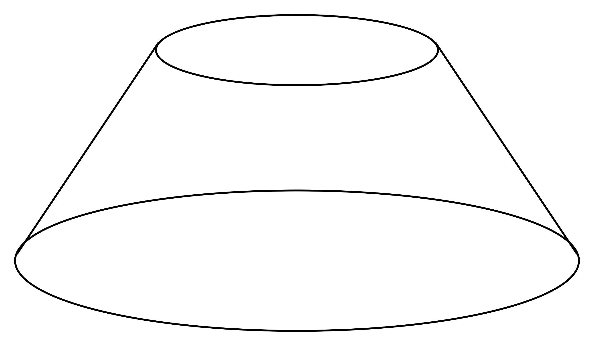

# AVP0988 — Single visual target

VisioMath:56_A / DynaMath:126 · same type · Mathematical roles of graphical elements

[Left image in official archive](https://raw.githubusercontent.com/Nefefilibata/VisioMath/4a912153e110001da261917902e1d3cc163b7c6a/data/images.zip) · `images/56_A.jpg`

## Shared or similar visual information

A closed oval at the top of a depicted solid.

## Evidence locations

- Left image: The full oval at the top of the cylinder.
- Right image: The smaller oval at the top of the truncated cone.

## Mathematical meanings

Left image: A circular rim shown as an ellipse in a perspective drawing of a solid. Right image: A circular rim shown as an ellipse in a perspective drawing of a solid.

## Same mathematical meanings

yes

## Rationales

Each oval meets side edges descending from its left and right extremities. This attachment identifies a circular upper rim seen in perspective.

Only the selected target is annotated. AI visual-review draft; not independently double-annotated by humans.
