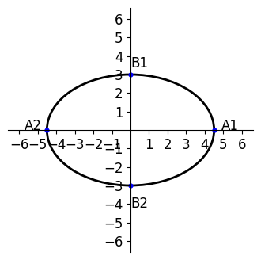

# AVP0994 — Single visual target

VisioMath:1068_A / DynaMath:175 · different type · Mathematical roles of graphical elements

[Left image in official archive](https://raw.githubusercontent.com/Nefefilibata/VisioMath/4a912153e110001da261917902e1d3cc163b7c6a/data/images.zip) · `images/1068_A.jpg`

## Shared or similar visual information

A closed oval.

## Evidence locations

- Left image: The solid oval at the top of the upright cylinder.
- Right image: The black ellipse passing through the four marked coordinate-axis points.

## Mathematical meanings

Left image: A circular rim shown as an ellipse in a perspective drawing of a solid. Right image: A closed planar locus plotted in the Cartesian coordinate plane.

## Same mathematical meanings

no

## Rationales

The oval attached to the solid’s side edges depicts a circular rim in perspective. The oval through marked axis positions is a planar ellipse in a coordinate system.

Only the selected target is annotated. AI visual-review draft; not independently double-annotated by humans.
