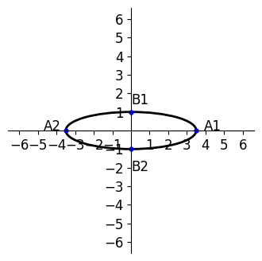

# AVP0995 — Single visual target

DynaMath:176 / VisioMath:1218_A · different type · Mathematical roles of graphical elements

[Right image in official archive](https://raw.githubusercontent.com/Nefefilibata/VisioMath/4a912153e110001da261917902e1d3cc163b7c6a/data/images.zip) · `images/1218_A.jpg`

## Shared or similar visual information

A closed oval.

## Evidence locations

- Left image: The closed black ellipse centered on the axes.
- Right image: The oval across the upper rim of the cylinder.

## Mathematical meanings

Left image: A closed planar locus plotted in the Cartesian coordinate plane. Right image: A circular rim shown as an ellipse in a perspective drawing of a solid.

## Same mathematical meanings

no

## Rationales

The oval attached to the solid’s side edges depicts a circular rim in perspective. The oval through marked axis positions is a planar ellipse in a coordinate system.

Only the selected target is annotated. AI visual-review draft; not independently double-annotated by humans.
