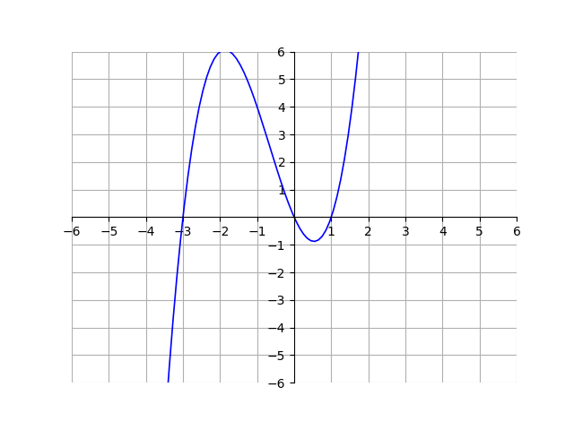

# AVP0997 — Single visual target

DynaMath:23 / VisioMath:147_A · different type · Mathematical roles of graphical elements

[Right image in official archive](https://raw.githubusercontent.com/Nefefilibata/VisioMath/4a912153e110001da261917902e1d3cc163b7c6a/data/images.zip) · `images/147_A.jpg`

## Shared or similar visual information

A small square outline.

## Evidence locations

- Left image: One complete square in the coordinate grid to the right of the blue curve.
- Right image: The square front face of the upper cube.

## Mathematical meanings

Left image: A background coordinate grid cell used to read positions on the plot. Right image: The boundary of a visible front face of one cube in the three-dimensional construction.

## Same mathematical meanings

no

## Rationales

The square joining adjacent cube faces is a boundary of a three-dimensional object. The repeated pale square within coordinate axes is a reference cell for reading graph positions.

Only the selected target is annotated. AI visual-review draft; not independently double-annotated by humans.
