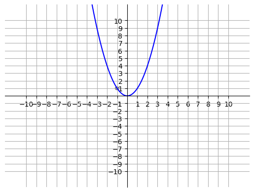

# AVP0998 — Single visual target

VisioMath:233_A / DynaMath:46 · different type · Mathematical roles of graphical elements

[Left image in official archive](https://raw.githubusercontent.com/Nefefilibata/VisioMath/4a912153e110001da261917902e1d3cc163b7c6a/data/images.zip) · `images/233_A.jpg`

## Shared or similar visual information

A small square outline.

## Evidence locations

- Left image: The square front face of the uppermost cube.
- Right image: One complete square in the background grid away from the U-shaped trace.

## Mathematical meanings

Left image: The boundary of a visible front face of one cube in the three-dimensional construction. Right image: A background coordinate grid cell used to read positions on the plot.

## Same mathematical meanings

no

## Rationales

The square joining adjacent cube faces is a boundary of a three-dimensional object. The repeated pale square within coordinate axes is a reference cell for reading graph positions.

Only the selected target is annotated. AI visual-review draft; not independently double-annotated by humans.
