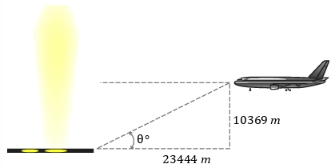
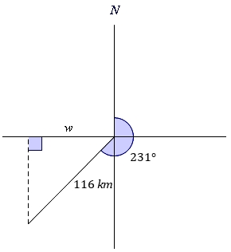

# AVP1001 — Single visual target

MathVerse:365 / MathVerse:345 · same type · Geometric markers

## Shared or similar visual information

A vertical dashed line.

## Evidence locations

- Left image: The vertical dashed leg below the airplane.
- Right image: The vertical dashed projection below the left portion of the horizontal line.

## Mathematical meanings

Left image: The line represents the vertical separation from the airplane to the lower horizontal reference. Right image: The line represents the vertical component from the lower point up to the horizontal reference.

## Same mathematical meanings

yes

## Rationales

Both images use the mark in the same way: a vertical auxiliary segment marks a perpendicular height relative to a geometric base.

Only the selected target is annotated. AI visual-review draft; not independently double-annotated by humans.
