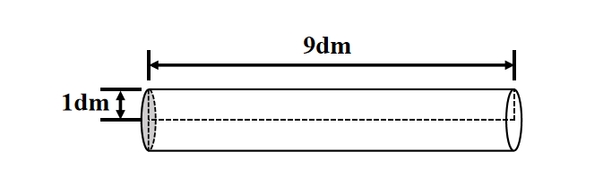
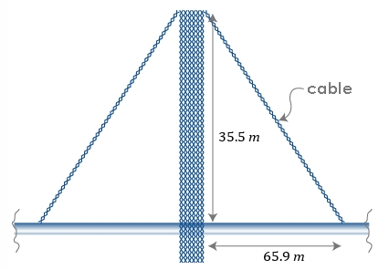

# AVP1003 — Single visual target

We-Math:654 / MathVerse:364 · different type · Geometric markers

## Shared or similar visual information

A horizontal double-headed arrow separate from the coordinate axes.

## Evidence locations

- Left image: The long horizontal double-headed arrow above the cylinder.
- Right image: The double-headed horizontal arrow to the right of the bridge tower.

## Mathematical meanings

Left image: The arrow gives the cylinder's 9 dm axial length. Right image: The arrow gives the horizontal run of 65.9 m between the tower and cable attachment.

## Same mathematical meanings

yes

## Rationales

Both images use the mark in the same way: the endpoints of the arrow delimit a spatial length on the construction.

Only the selected target is annotated. AI visual-review draft; not independently double-annotated by humans.
