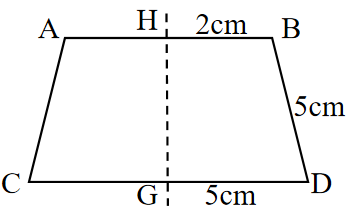

# AVP1004 — Single visual target

VisioMath:55_A / We-Math:116 · different type · Geometric markers

[Left image in official archive](https://raw.githubusercontent.com/Nefefilibata/VisioMath/4a912153e110001da261917902e1d3cc163b7c6a/data/images.zip) · `images/55_A.jpg`

## Shared or similar visual information

A vertical dashed line.

## Evidence locations

- Left image: The dashed line from the triangular graph's peak down to 8.
- Right image: The vertical dashed line HG through both bases of the trapezoid.

## Mathematical meanings

Left image: The line projects the graph's peak to t = 8. Right image: The line is the given symmetry axis of the trapezoid.

## Same mathematical meanings

no

## Rationales

In the left image, the vertical dashed segment projects a plotted position to its horizontal coordinate. In the right image, the dashed line is the axis used to reflect a geometric figure.

Only the selected target is annotated. AI visual-review draft; not independently double-annotated by humans.
