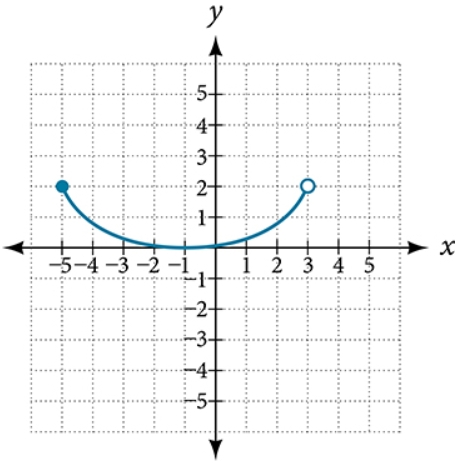

# AVP1008 — Single visual target

MathVerse:484 / VisioMath:131_C · same type · Domain and solution-set constraints

[Right image in official archive](https://raw.githubusercontent.com/Nefefilibata/VisioMath/4a912153e110001da261917902e1d3cc163b7c6a/data/images.zip) · `images/131_C.jpg`

## Shared or similar visual information

Circular marker at the edge of a marked interval or at a point on a plotted trace. Compare the mark at (3,2) on the left with the mark at x=10 where the arch reaches the horizontal axis on the right.

## Evidence locations

- Left image: The hollow blue circle at (3,2), at the right end of the curve.
- Right image: The hollow circle at x=10 at the end of the arch.

## Mathematical meanings

Left image: The displayed function has no value at x=3. Right image: The displayed function has no value at x=10.

## Same mathematical meanings

yes

## Rationales

On the left, the hollow marker omits the indicated point and there is no other plotted value at x=3. On the right, the hollow marker omits the indicated point and there is no other plotted value at x=10.

## Reasoning consequence

A solver must leave x=3 outside the displayed domain on the left and must leave x=10 outside the displayed domain on the right.

Only the selected target is annotated. AI visual-review draft; not independently double-annotated by humans.
