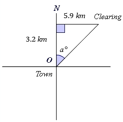

# AVP1009 — Single visual target

MathVerse:343 / MathVerse:331 · same type · Geometric markers

## Shared or similar visual information

A circular arc.

## Evidence locations

- Left image: The arc edge of the shaded wedge at the town O.
- Right image: The arc edge of the red wedge at A.

## Mathematical meanings

Left image: The arc marks the angle between the northerly direction and the direction toward the clearing. Right image: The arc marks the 45-degree angle between AP and the north ray.

## Same mathematical meanings

yes

## Rationales

Both images use the mark in the same way: the arc is drawn inside a vertex angle to show which angle is selected.

Only the selected target is annotated. AI visual-review draft; not independently double-annotated by humans.
