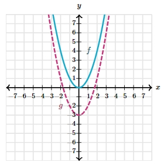

# AVP1011 — Single visual target

MathVerse:569 / VisioMath:1414_A · different type · Geometric markers

[Right image in official archive](https://raw.githubusercontent.com/Nefefilibata/VisioMath/4a912153e110001da261917902e1d3cc163b7c6a/data/images.zip) · `images/1414_A.jpg`

## Shared or similar visual information

A dashed curve.

## Evidence locations

- Left image: The dashed magenta parabola below the other parabola near the vertical axis.
- Right image: The dashed rear arc of the larger bottom rim.

## Mathematical meanings

Left image: The curve is the second function graph, distinguished by its dashed treatment. Right image: The arc depicts the hidden lower rim of the truncated cone.

## Same mathematical meanings

no

## Rationales

In the left image, the dashed curve itself plots a function. In the right image, the dashes trace an occluded portion of a circular rim in a solid diagram.

Only the selected target is annotated. AI visual-review draft; not independently double-annotated by humans.
