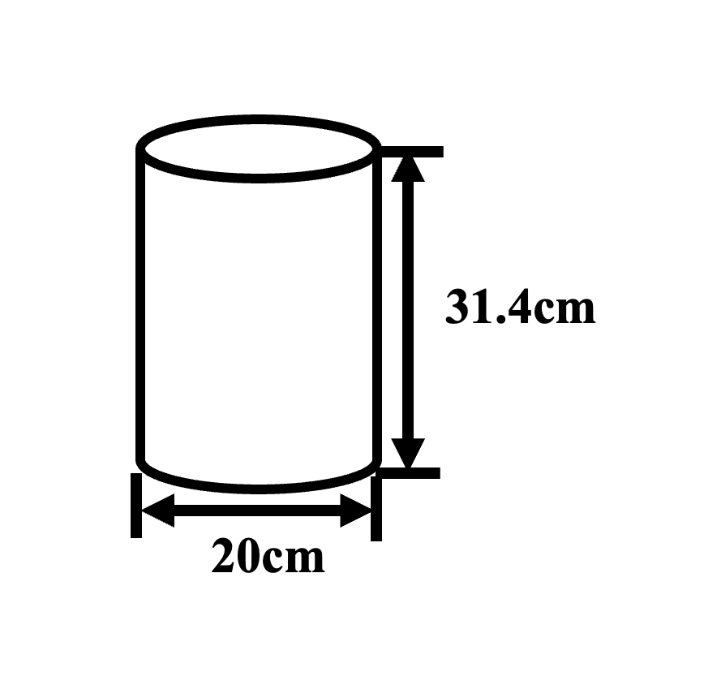
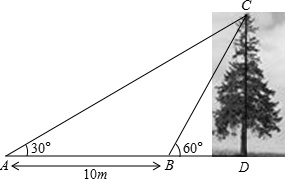

# AVP1012 — Single visual target

We-Math:653 / MathVista:523 · different type · Geometric markers

## Shared or similar visual information

A horizontal double-headed arrow separate from the coordinate axes.

## Evidence locations

- Left image: The lower horizontal double-headed arrow.
- Right image: The horizontal arrow beneath the pair of sight lines.

## Mathematical meanings

Left image: The arrow gives the cylinder's 20 cm base diameter. Right image: The arrow gives the 10 m horizontal distance AB between the two observation points.

## Same mathematical meanings

yes

## Rationales

Both images use the mark in the same way: the endpoints of the arrow delimit a spatial length on the construction.

Only the selected target is annotated. AI visual-review draft; not independently double-annotated by humans.
