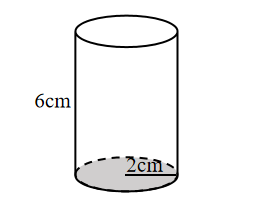

# AVP1014 — Single visual target

VisioMath:59_A / We-Math:1422 · same type · Geometric markers

[Left image in official archive](https://raw.githubusercontent.com/Nefefilibata/VisioMath/4a912153e110001da261917902e1d3cc163b7c6a/data/images.zip) · `images/59_A.jpg`

## Shared or similar visual information

A dashed curve.

## Evidence locations

- Left image: The dashed arc on the end at the right of the horizontal cylinder.
- Right image: The dashed back arc of the gray lower oval.

## Mathematical meanings

Left image: The arc traces the hidden portion of the right end rim. Right image: The arc depicts the hidden rear part of the cylinder's base rim.

## Same mathematical meanings

yes

## Rationales

Both images use the mark in the same way: the dashes trace an occluded portion of a circular rim in a solid diagram.

Only the selected target is annotated. AI visual-review draft; not independently double-annotated by humans.
