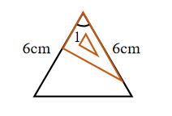
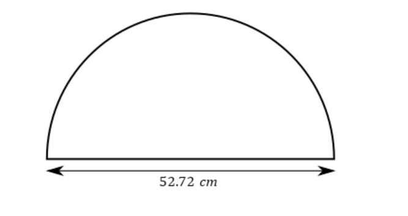

# AVP1015 — Single visual target

We-Math:1146 / MathVerse:402 · same type · Geometric markers

## Shared or similar visual information

A circular arc.

## Evidence locations

- Left image: The short curved mark just inside the orange apex.
- Right image: The upper curved outline above the 52.72 cm dimension arrow.

## Mathematical meanings

Left image: The arc identifies the triangle apex angle labeled 1. Right image: The arc is the semicircular boundary above the diameter.

## Same mathematical meanings

no

## Rationales

In the left image, the arc is drawn inside a vertex angle to show which angle is selected. In the right image, the arc forms a part of the boundary of a geometric figure.

Only the selected target is annotated. AI visual-review draft; not independently double-annotated by humans.
