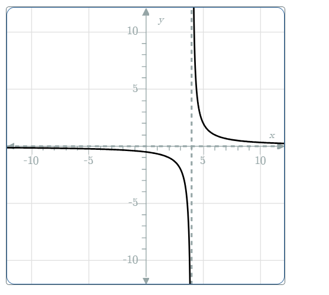
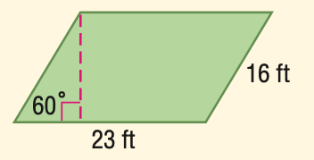

# AVP1021 — Single visual target

MathVerse:582 / MathVista:737 · different type · Geometric markers

## Shared or similar visual information

A vertical dashed line.

## Evidence locations

- Left image: The vertical dashed reference between the two black branches.
- Right image: The magenta dashed vertical segment from the upper-left vertex.

## Mathematical meanings

Left image: The line marks the vertical asymptote approached by the two branches. Right image: The line represents the perpendicular height of the parallelogram.

## Same mathematical meanings

no

## Rationales

In the left image, the dashed line marks a vertical asymptote approached by the curve. In the right image, a vertical auxiliary segment marks a perpendicular height relative to a geometric base.

Only the selected target is annotated. AI visual-review draft; not independently double-annotated by humans.
