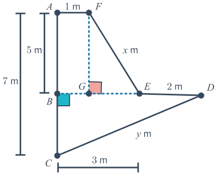

# AVP1023 — Single visual target

VisioMath:1400_A / MathVerse:368 · different type · Geometric markers

[Left image in official archive](https://raw.githubusercontent.com/Nefefilibata/VisioMath/4a912153e110001da261917902e1d3cc163b7c6a/data/images.zip) · `images/1400_A.jpg`

## Shared or similar visual information

A vertical dashed line.

## Evidence locations

- Left image: The vertical dashed line at x = 100.
- Right image: The vertical blue dashed segment between F and G.

## Mathematical meanings

Left image: The line projects the plot's peak onto x = 100. Right image: The line represents the perpendicular height FG to the horizontal line through G.

## Same mathematical meanings

no

## Rationales

In the left image, the vertical dashed segment projects a plotted position to its horizontal coordinate. In the right image, a vertical auxiliary segment marks a perpendicular height relative to a geometric base.

Only the selected target is annotated. AI visual-review draft; not independently double-annotated by humans.
