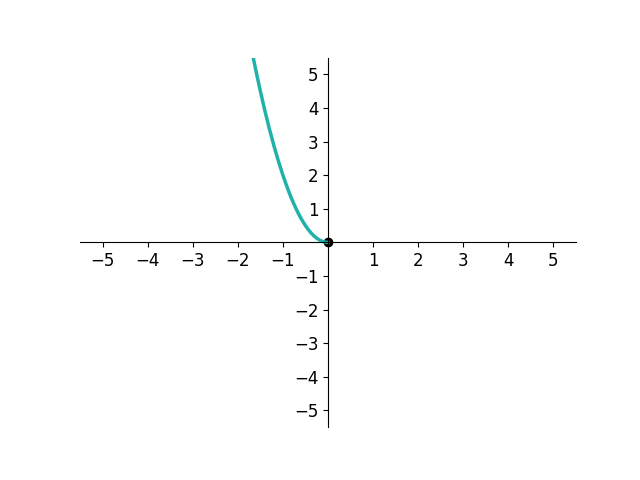

# AVP1026 — Single visual target

DynaMath:125 / VisioMath:1115_A · same type · Domain and solution-set constraints

[Right image in official archive](https://raw.githubusercontent.com/Nefefilibata/VisioMath/4a912153e110001da261917902e1d3cc163b7c6a/data/images.zip) · `images/1115_A.jpg`

## Shared or similar visual information

Circular marker at the edge of a marked interval or at a point on a plotted trace. Compare the mark at the origin on the left with the left-hand mark at t=2√2 on the right.

## Evidence locations

- Left image: The filled dot at the origin, where the turquoise curve ends.
- Right image: The filled dot at the upper left endpoint, aligned with t=2√2 and S=4√2.

## Mathematical meanings

Left image: The point belongs to the plotted graph and gives f(0)=0. Right image: The point belongs to the plotted graph and gives S(2√2)=4√2.

## Same mathematical meanings

yes

## Rationales

On the left, the filled marker adds that coordinate pair to the graph and supplies the value at its horizontal coordinate. On the right, the filled marker adds that coordinate pair to the graph and supplies the value at its horizontal coordinate.

## Reasoning consequence

A solver can read f(0)=0 from the included point on the left and can read S(2√2)=4√2 from the included point on the right.

Only the selected target is annotated. AI visual-review draft; not independently double-annotated by humans.
