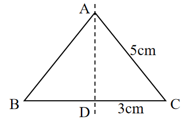
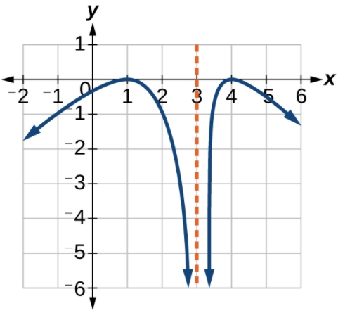

# AVP1032 — Single visual target

We-Math:115 / MathVerse:489 · different type · Geometric markers

## Shared or similar visual information

A vertical dashed line.

## Evidence locations

- Left image: The vertical dashed line through A and D.
- Right image: The orange dashed vertical line at x = 3.

## Mathematical meanings

Left image: The line is the symmetry axis through the apex and the base of the triangle. Right image: The line marks the vertical asymptote at x = 3.

## Same mathematical meanings

no

## Rationales

In the left image, the dashed line is the axis used to reflect a geometric figure. In the right image, the dashed line marks a vertical asymptote approached by the curve.

Only the selected target is annotated. AI visual-review draft; not independently double-annotated by humans.
