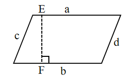
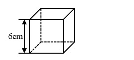

# AVP1034 — Single visual target

We-Math:497 / We-Math:666 · different type · Geometric markers

## Shared or similar visual information

A vertical dashed line.

## Evidence locations

- Left image: The vertical dashed segment EF in the parallelogram.
- Right image: The dashed vertical segment within the cube outline.

## Mathematical meanings

Left image: The line represents the perpendicular height between the parallelogram bases. Right image: The line depicts the cube's hidden vertical edge.

## Same mathematical meanings

no

## Rationales

In the left image, a vertical auxiliary segment marks a perpendicular height relative to a geometric base. In the right image, the dashed vertical segment depicts an occluded edge of a solid.

Only the selected target is annotated. AI visual-review draft; not independently double-annotated by humans.
