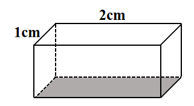

# AVP1036 — Single visual target

MathVerse:542 / We-Math:267 · different type · Geometric markers

## Shared or similar visual information

A horizontal dashed line.

## Evidence locations

- Left image: The magenta dashed horizontal line through the lower orange point.
- Right image: The horizontal dashed segment along the shaded bottom face's rear edge.

## Mathematical meanings

Left image: The line gives the sinusoid's midline at y = 3.3. Right image: The line depicts a hidden bottom edge of the solid.

## Same mathematical meanings

no

## Rationales

In the left image, the dashed line gives the midline about which a wave oscillates. In the right image, the dashes indicate a hidden horizontal edge of a solid.

Only the selected target is annotated. AI visual-review draft; not independently double-annotated by humans.
