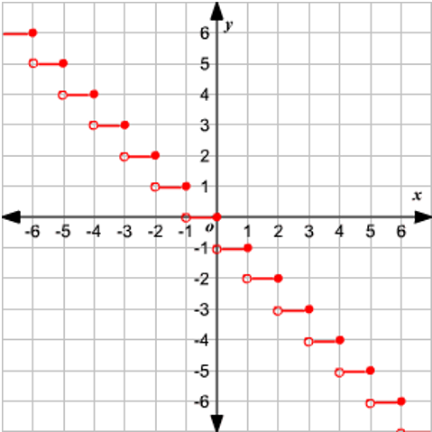

# AVP1037 — Single visual target

VisioMath:1031_C / MathVista:34 · different type · Domain and solution-set constraints

[Left image in official archive](https://raw.githubusercontent.com/Nefefilibata/VisioMath/4a912153e110001da261917902e1d3cc163b7c6a/data/images.zip) · `images/1031_C.jpg`

## Shared or similar visual information

Circular marker at the edge of a marked interval or at a point on a plotted trace. Compare the mark at 2 on the number line on the left with the mark at the origin on the right.

## Evidence locations

- Left image: The filled circular marker at 2, where the raised horizontal stroke extends left.
- Right image: The filled right endpoint of the red staircase segment at the origin.

## Mathematical meanings

Left image: The displayed set includes 2 at its upper bound. Right image: The point belongs to the plotted graph and gives f(0)=0.

## Same mathematical meanings

yes

## Rationales

On the left, the filled endpoint marks an inclusive boundary of the marked ray. On the right, the filled marker adds that coordinate pair to the graph and supplies the value at its horizontal coordinate.

## Reasoning consequence

A solver can accept 2 as a member of the displayed set on the left and can read f(0)=0 from the included point on the right.

Only the selected target is annotated. AI visual-review draft; not independently double-annotated by humans.
