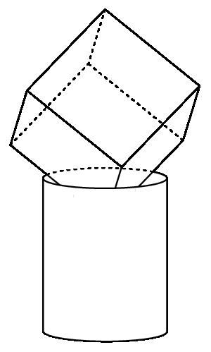

# AVP1039 — Single visual target

VisioMath:1226_A / MathVision:2088 · same type · Geometric markers

[Left image in official archive](https://raw.githubusercontent.com/Nefefilibata/VisioMath/4a912153e110001da261917902e1d3cc163b7c6a/data/images.zip) · `images/1226_A.jpg`

## Shared or similar visual information

A dashed curve.

## Evidence locations

- Left image: The dashed arc crossing the interior of the dome drawing.
- Right image: The curved dashed portion of the upper opening of the cylinder.

## Mathematical meanings

Left image: The arc depicts the rear portion of the hemisphere's base rim. Right image: The arc shows the rear part of the cylinder rim in the composite solid drawing.

## Same mathematical meanings

yes

## Rationales

Both images use the mark in the same way: the dashes trace an occluded portion of a circular rim in a solid diagram.

Only the selected target is annotated. AI visual-review draft; not independently double-annotated by humans.
