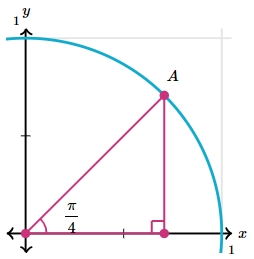

# AVP1041 — Single visual target

VisioMath:1703_A / MathVerse:439 · different type · Geometric markers

[Left image in official archive](https://raw.githubusercontent.com/Nefefilibata/VisioMath/4a912153e110001da261917902e1d3cc163b7c6a/data/images.zip) · `images/1703_A.jpg`

## Shared or similar visual information

An upward arrow on a straight vertical line.

## Evidence locations

- Left image: The upward arrow above the radical label on the y-axis.
- Right image: The upward arrow at the top of the axis labeled y.

## Mathematical meanings

Left image: The arrow marks the increasing y-coordinate direction. Right image: The arrow indicates the positive direction of the vertical coordinate.

## Same mathematical meanings

yes

## Rationales

Both images use the mark in the same way: the arrow indicates the increasing direction of the vertical coordinate.

Only the selected target is annotated. AI visual-review draft; not independently double-annotated by humans.
