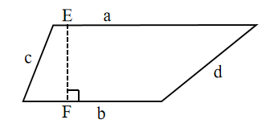
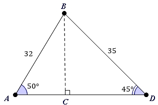

# AVP1043 — Single visual target

We-Math:498 / MathVerse:354 · same type · Geometric markers

## Shared or similar visual information

A vertical dashed line.

## Evidence locations

- Left image: The vertical dashed segment EF in the trapezoid.
- Right image: The dashed segment between B and C.

## Mathematical meanings

Left image: The line represents the perpendicular height between the trapezoid bases. Right image: The line represents the triangle altitude from B to AD.

## Same mathematical meanings

yes

## Rationales

Both images use the mark in the same way: a vertical auxiliary segment marks a perpendicular height relative to a geometric base.

Only the selected target is annotated. AI visual-review draft; not independently double-annotated by humans.
