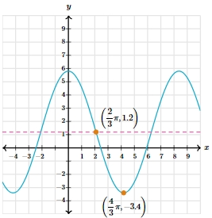
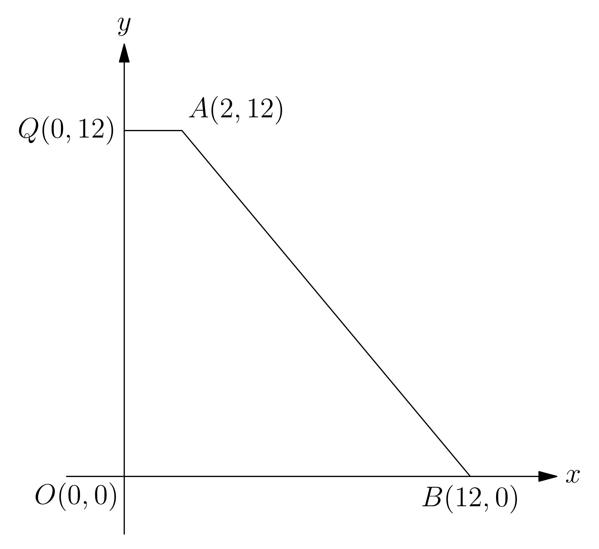

# AVP1046 — Single visual target

MathVerse:535 / MathVision:2958 · different type · Geometric markers

## Shared or similar visual information

An upward arrow on a straight vertical line.

## Evidence locations

- Left image: The upward arrow above the scale on the axis labeled y.
- Right image: The upward arrow above Q on the line labeled y.

## Mathematical meanings

Left image: The arrow indicates the increasing vertical coordinate direction. Right image: The arrow indicates the positive direction of the y-axis.

## Same mathematical meanings

yes

## Rationales

Both images use the mark in the same way: the arrow indicates the increasing direction of the vertical coordinate.

Only the selected target is annotated. AI visual-review draft; not independently double-annotated by humans.
