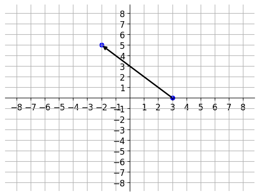

# AVP1047 — Single visual target

VisioMath:1115_A / DynaMath:158 · same type · Domain and solution-set constraints

[Left image in official archive](https://raw.githubusercontent.com/Nefefilibata/VisioMath/4a912153e110001da261917902e1d3cc163b7c6a/data/images.zip) · `images/1115_A.jpg`

## Shared or similar visual information

Circular marker at the edge of a marked interval or at a point on a plotted trace. Compare the right-hand mark at t=4√6/3 on the left with the right-hand mark at (3,0) on the right.

## Evidence locations

- Left image: The rightmost hollow endpoint at t=4√6/3.
- Right image: The filled blue dot at (3,0) at the right end of the black segment.

## Mathematical meanings

Left image: The displayed function has no value at t=4√6/3. Right image: The point belongs to the plotted graph and gives f(3)=0.

## Same mathematical meanings

no

## Rationales

On the left, the hollow marker omits the indicated point and there is no other plotted value at t=4√6/3. On the right, the filled marker adds that coordinate pair to the graph and supplies the value at its horizontal coordinate.

## Reasoning consequence

A solver must leave t=4√6/3 outside the displayed domain on the left and can read f(3)=0 from the included point on the right.

Only the selected target is annotated. AI visual-review draft; not independently double-annotated by humans.
