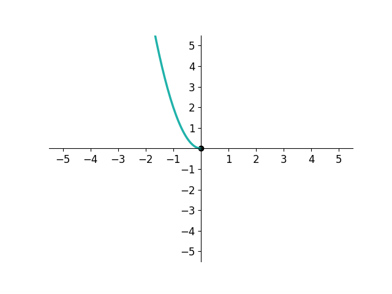

# AVP1050 — Single visual target

DynaMath:125 / MathVerse:481 · same type · Domain and solution-set constraints

## Shared or similar visual information

Circular marker at the edge of a marked interval or at a point on a plotted trace. Compare the mark at the origin on the left with the mark at (−3,0) on the right.

## Evidence locations

- Left image: The filled dot at the origin, where the turquoise curve ends.
- Right image: The hollow circle at (−3,0), at the left edge of the blue curve.

## Mathematical meanings

Left image: The point belongs to the plotted graph and gives f(0)=0. Right image: The displayed function has no value at x=−3.

## Same mathematical meanings

no

## Rationales

On the left, the filled marker adds that coordinate pair to the graph and supplies the value at its horizontal coordinate. On the right, the hollow marker omits the indicated point and there is no other plotted value at x=−3.

## Reasoning consequence

A solver can read f(0)=0 from the included point on the left and must leave x=−3 outside the displayed domain on the right.

Only the selected target is annotated. AI visual-review draft; not independently double-annotated by humans.
