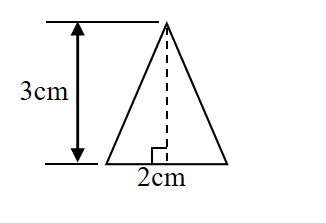
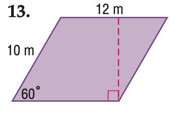

# AVP1053 — Single visual target

We-Math:1426 / MathVista:822 · same type · Geometric markers

## Shared or similar visual information

A vertical dashed line.

## Evidence locations

- Left image: The vertical dashed segment inside the triangle.
- Right image: The magenta vertical dashes descending to the lower-right corner.

## Mathematical meanings

Left image: The line represents the altitude to the triangle's base. Right image: The line represents the perpendicular distance between the parallelogram bases.

## Same mathematical meanings

yes

## Rationales

Both images use the mark in the same way: a vertical auxiliary segment marks a perpendicular height relative to a geometric base.

Only the selected target is annotated. AI visual-review draft; not independently double-annotated by humans.
