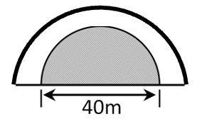
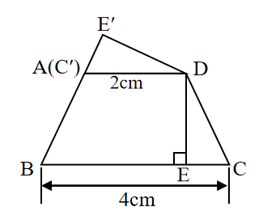

# AVP1054 — Single visual target

We-Math:119 / We-Math:1248 · same type · Geometric markers

## Shared or similar visual information

A horizontal double-headed arrow separate from the coordinate axes.

## Evidence locations

- Left image: The horizontal arrow below the gray semicircle.
- Right image: The double-headed arrow below BC, labeled 4 cm.

## Mathematical meanings

Left image: The arrow gives the gray semicircle's diameter of 40 m. Right image: The arrow gives the base length BC, 4 cm.

## Same mathematical meanings

yes

## Rationales

Both images use the mark in the same way: the endpoints of the arrow delimit a spatial length on the construction.

Only the selected target is annotated. AI visual-review draft; not independently double-annotated by humans.
