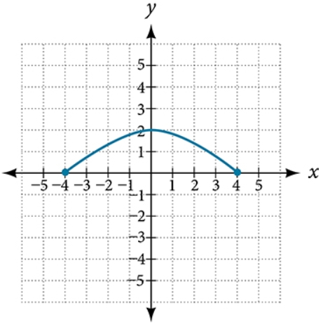

# AVP1055 — Single visual target

VisioMath:1463_A / MathVerse:483 · different type · Domain and solution-set constraints

[Left image in official archive](https://raw.githubusercontent.com/Nefefilibata/VisioMath/4a912153e110001da261917902e1d3cc163b7c6a/data/images.zip) · `images/1463_A.jpg`

## Shared or similar visual information

Circular marker at the edge of a marked interval or at a point on a plotted trace. Compare the mark at 1 on the number line on the left with the mark at (−4,0) on the right.

## Evidence locations

- Left image: The hollow circular marker at 1, where the raised horizontal stroke extends left.
- Right image: The left filled dot at (−4,0), where the blue arch begins.

## Mathematical meanings

Left image: The displayed set excludes 1 at its upper bound. Right image: The point belongs to the plotted graph and gives f(−4)=0.

## Same mathematical meanings

no

## Rationales

On the left, the hollow endpoint marks a strict boundary of the marked ray. On the right, the filled marker adds that coordinate pair to the graph and supplies the value at its horizontal coordinate.

## Reasoning consequence

A solver can reject 1 as a member of the displayed set on the left and can read f(−4)=0 from the included point on the right.

Only the selected target is annotated. AI visual-review draft; not independently double-annotated by humans.
