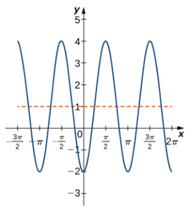

# AVP1055 — Single visual target

MathVista:592 / VisioMath:1654_A · same type · Geometric markers

[Right image in official archive](https://raw.githubusercontent.com/Nefefilibata/VisioMath/4a912153e110001da261917902e1d3cc163b7c6a/data/images.zip) · `images/1654_A.jpg`

## Shared or similar visual information

A horizontal dashed line.

## Evidence locations

- Left image: The orange dashed horizontal line crossing the wave at y = 1.
- Right image: The short horizontal dashed line from 24 to the beginning of the plateau.

## Mathematical meanings

Left image: The line gives the vertical midpoint of the plotted wave at y = 1. Right image: It gives the constant plotted area of 24 square centimeters.

## Same mathematical meanings

no

## Rationales

In the left image, the dashed line gives the midline about which a wave oscillates. In the right image, the horizontal dashed segment projects a plotted point or plateau to its ordinate.

Only the selected target is annotated. AI visual-review draft; not independently double-annotated by humans.
