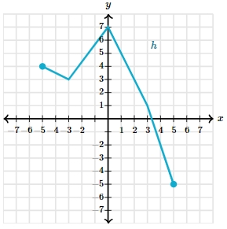

# AVP1056 — Single visual target

MathVerse:558 / VisioMath:1470_A · different type · Domain and solution-set constraints

[Right image in official archive](https://raw.githubusercontent.com/Nefefilibata/VisioMath/4a912153e110001da261917902e1d3cc163b7c6a/data/images.zip) · `images/1470_A.jpg`

## Shared or similar visual information

Circular marker at the edge of a marked interval or at a point on a plotted trace. Compare the mark at (5,−5) on the left with the mark at 1 on the number line on the right.

## Evidence locations

- Left image: The filled right endpoint of h at (5,−5).
- Right image: The hollow circular marker at 1, where the raised horizontal stroke extends right.

## Mathematical meanings

Left image: The point belongs to the plotted graph and gives h(5)=−5. Right image: The displayed set excludes 1 at its lower bound.

## Same mathematical meanings

no

## Rationales

On the left, the filled marker adds that coordinate pair to the graph and supplies the value at its horizontal coordinate. On the right, the hollow endpoint marks a strict boundary of the marked ray.

## Reasoning consequence

A solver can read h(5)=−5 from the included point on the left and can reject 1 as a member of the displayed set on the right.

Only the selected target is annotated. AI visual-review draft; not independently double-annotated by humans.
