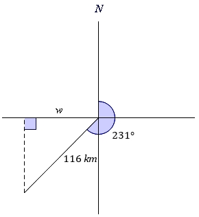

# AVP1059 — Single visual target

MathVerse:345 / VisioMath:639_A · different type · Geometric markers

[Right image in official archive](https://raw.githubusercontent.com/Nefefilibata/VisioMath/4a912153e110001da261917902e1d3cc163b7c6a/data/images.zip) · `images/639_A.jpg`

## Shared or similar visual information

A vertical dashed line.

## Evidence locations

- Left image: The vertical dashed projection below the left portion of the horizontal line.
- Right image: The vertical dashes descending from the bend to 4.

## Mathematical meanings

Left image: The line represents the vertical component from the lower point up to the horizontal reference. Right image: The line projects the change in slope to x = 4.

## Same mathematical meanings

no

## Rationales

In the left image, a vertical auxiliary segment marks a perpendicular height relative to a geometric base. In the right image, the vertical dashed segment projects a plotted position to its horizontal coordinate.

Only the selected target is annotated. AI visual-review draft; not independently double-annotated by humans.
