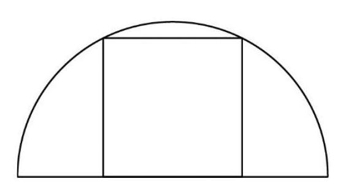

# AVP1062 — Single visual target

MathVision:1434 / MathVerse:331 · same type · Geometric markers

## Shared or similar visual information

A circular arc.

## Evidence locations

- Left image: The large semicircular outline above the baseline.
- Right image: The arc edge of the red wedge at A.

## Mathematical meanings

Left image: The arc is the curved boundary of the semicircular figure enclosing the rectangle. Right image: The arc marks the 45-degree angle between AP and the north ray.

## Same mathematical meanings

no

## Rationales

In the left image, the arc forms a part of the boundary of a geometric figure. In the right image, the arc is drawn inside a vertex angle to show which angle is selected.

Only the selected target is annotated. AI visual-review draft; not independently double-annotated by humans.
