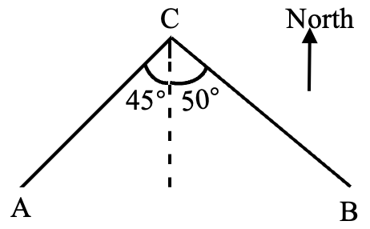
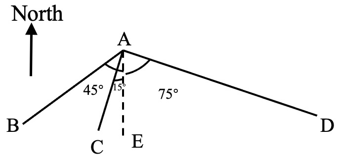

# AVP1068 — Single visual target

We-Math:1574 / We-Math:1562 · same type · Geometric markers

## Shared or similar visual information

An upward arrow on a straight vertical line.

## Evidence locations

- Left image: The upward arrow next to the label North to the right of C.
- Right image: The upward arrow under North at the upper left of the diagram.

## Mathematical meanings

Left image: The arrow establishes the north direction for the two-angle diagram. Right image: The arrow gives the north reference of the construction.

## Same mathematical meanings

yes

## Rationales

Both images use the mark in the same way: the arrow sets the compass-north reference for the geometry.

Only the selected target is annotated. AI visual-review draft; not independently double-annotated by humans.
