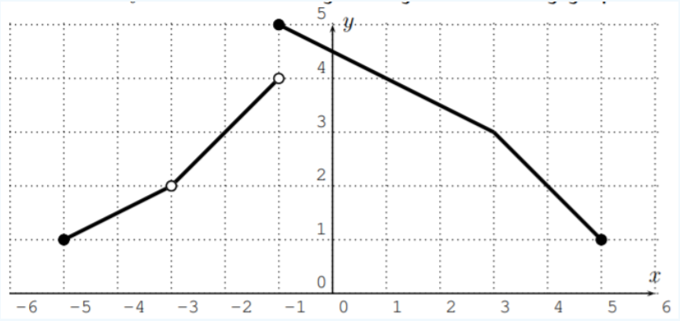

# AVP1069 — Single visual target

VisioMath:1499_C / MathVerse:602 · different type · Domain and solution-set constraints

[Left image in official archive](https://raw.githubusercontent.com/Nefefilibata/VisioMath/4a912153e110001da261917902e1d3cc163b7c6a/data/images.zip) · `images/1499_C.jpg`

## Shared or similar visual information

Circular marker at the edge of a marked interval or at a point on a plotted trace. Compare the mark at 3 on the number line on the left with the mark at (−1,4) on the right.

## Evidence locations

- Left image: The hollow circular marker at 3, at the right boundary of the gray interval between −1 and 3.
- Right image: The hollow point at (−1,4), immediately below the filled graph point at the same x.

## Mathematical meanings

Left image: The displayed interval excludes its boundary value 3. Right image: The point (−1,4) is excluded while the same input is still defined by f(−1)=5.

## Same mathematical meanings

no

## Rationales

On the left, the hollow dot makes equality at 3 inadmissible for the interval. On the right, the hollow marker excludes its plotted height only. The filled marker vertically aligned with it supplies the actual output at that input.

## Reasoning consequence

A solver can reject 3 as a member of the displayed interval on the left and must omit (−1,4) and use f(−1)=5 on the right.

Only the selected target is annotated. AI visual-review draft; not independently double-annotated by humans.
