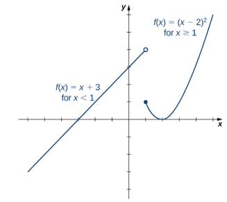

# AVP1070 — Single visual target

MathVista:156 / VisioMath:1797_B · different type · Domain and solution-set constraints

[Right image in official archive](https://raw.githubusercontent.com/Nefefilibata/VisioMath/4a912153e110001da261917902e1d3cc163b7c6a/data/images.zip) · `images/1797_B.jpg`

## Shared or similar visual information

Circular marker at the edge of a marked interval or at a point on a plotted trace. Compare the upper mark at x=1 on the left with the mark at 3 on the number line on the right.

## Evidence locations

- Left image: The hollow point at (1,4) at the end of the rising branch, above the filled point.
- Right image: The hollow circular marker at 3, where the raised horizontal stroke extends left.

## Mathematical meanings

Left image: The point (1,4) is excluded while the same input is still defined by f(1)=1. Right image: The displayed set excludes 3 at its upper bound.

## Same mathematical meanings

no

## Rationales

On the left, the hollow marker excludes its plotted height only. The filled marker vertically aligned with it supplies the actual output at that input. On the right, the hollow endpoint marks a strict boundary of the marked ray.

## Reasoning consequence

A solver must omit (1,4) and use f(1)=1 on the left and can reject 3 as a member of the displayed set on the right.

Only the selected target is annotated. AI visual-review draft; not independently double-annotated by humans.
