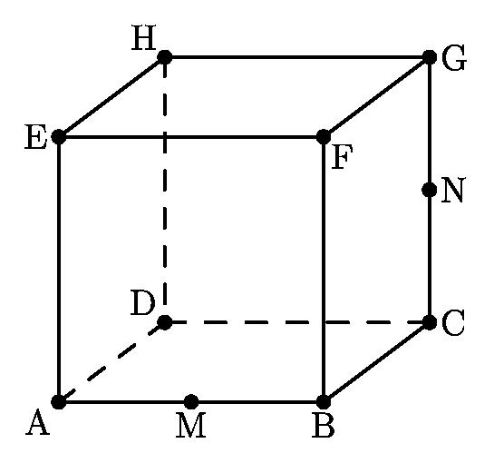

# AVP1073 — Single visual target

MathVision:2078 / VisioMath:505_A · same type · Geometric markers

[Right image in official archive](https://raw.githubusercontent.com/Nefefilibata/VisioMath/4a912153e110001da261917902e1d3cc163b7c6a/data/images.zip) · `images/505_A.jpg`

## Shared or similar visual information

A vertical dashed line.

## Evidence locations

- Left image: The dashed vertical edge joining H and D.
- Right image: The vertical dashed segment at the rear-left corner of the cuboid.

## Mathematical meanings

Left image: The line depicts the hidden vertical edge HD of the solid. Right image: The line depicts the hidden vertical rear edge of the cuboid.

## Same mathematical meanings

yes

## Rationales

Both images use the mark in the same way: the dashed vertical segment depicts an occluded edge of a solid.

Only the selected target is annotated. AI visual-review draft; not independently double-annotated by humans.
