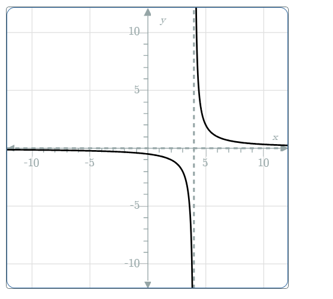
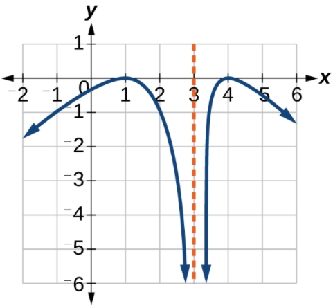

# AVP1075 — Single visual target

MathVerse:582 / MathVerse:489 · same type · Geometric markers

## Shared or similar visual information

A vertical dashed line.

## Evidence locations

- Left image: The vertical dashed reference between the two black branches.
- Right image: The orange dashed vertical line at x = 3.

## Mathematical meanings

Left image: The line marks the vertical asymptote approached by the two branches. Right image: The line marks the vertical asymptote at x = 3.

## Same mathematical meanings

yes

## Rationales

Both images use the mark in the same way: the dashed line marks a vertical asymptote approached by the curve.

Only the selected target is annotated. AI visual-review draft; not independently double-annotated by humans.
