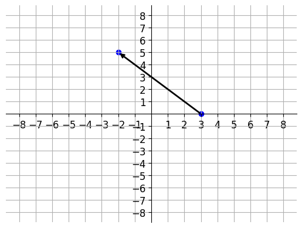

# AVP1079 — Single visual target

VisioMath:1142_D / DynaMath:158 · different type · Domain and solution-set constraints

[Left image in official archive](https://raw.githubusercontent.com/Nefefilibata/VisioMath/4a912153e110001da261917902e1d3cc163b7c6a/data/images.zip) · `images/1142_D.jpg`

## Shared or similar visual information

Circular marker at the edge of a marked interval or at a point on a plotted trace. Compare the mark at 3 on the number line on the left with the right-hand mark at (3,0) on the right. Where two raised traces are shown, consider values satisfying both constraints.

## Evidence locations

- Left image: The filled circular marker at 3, below the right-extending raised stroke, beyond the reach of the other marked ray.
- Right image: The filled blue dot at (3,0) at the right end of the black segment.

## Mathematical meanings

Left image: The filled dot admits 3 for its own bound, but the other constraint rejects that value. Right image: The point belongs to the plotted graph and gives f(3)=0.

## Same mathematical meanings

no

## Rationales

On the left, although the selected dot is filled, the other marked ray does not reach 3. The value is outside the intersection. On the right, the filled marker adds that coordinate pair to the graph and supplies the value at its horizontal coordinate.

## Reasoning consequence

A solver must reject 3 when both marked constraints are required on the left and can read f(3)=0 from the included point on the right.

Only the selected target is annotated. AI visual-review draft; not independently double-annotated by humans.
