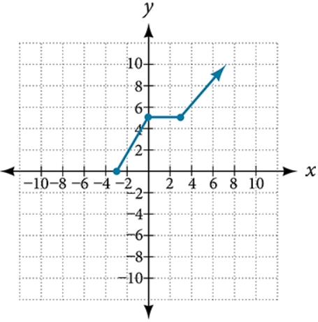

# AVP1080 — Single visual target

MathVerse:487 / VisioMath:1718_A · different type · Domain and solution-set constraints

[Right image in official archive](https://raw.githubusercontent.com/Nefefilibata/VisioMath/4a912153e110001da261917902e1d3cc163b7c6a/data/images.zip) · `images/1718_A.jpg`

## Shared or similar visual information

Circular marker at the edge of a marked interval or at a point on a plotted trace. Compare the left-hand mark at (−3,0) on the left with the mark at −2 on the number line on the right. Where two raised traces are shown, consider values satisfying both constraints.

## Evidence locations

- Left image: The leftmost filled blue dot at (−3,0), where the first rising branch begins.
- Right image: The filled circular marker at −2, below the left-extending raised stroke, beyond the reach of the other marked ray.

## Mathematical meanings

Left image: The point belongs to the plotted graph and gives f(−3)=0. Right image: The filled dot admits −2 for its own bound, but the other constraint rejects that value.

## Same mathematical meanings

no

## Rationales

On the left, the filled marker adds that coordinate pair to the graph and supplies the value at its horizontal coordinate. On the right, although the selected dot is filled, the other marked ray does not reach −2. The value is outside the intersection.

## Reasoning consequence

A solver can read f(−3)=0 from the included point on the left and must reject −2 when both marked constraints are required on the right.

Only the selected target is annotated. AI visual-review draft; not independently double-annotated by humans.
