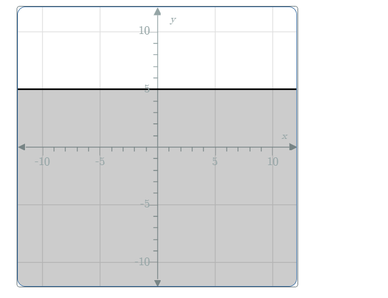

# AVP1081 — Single visual target

MathVerse:512 / MathVerse:509 · same type · Domain and solution-set constraints

## Shared or similar visual information

A straight boundary separating the shaded and unshaded parts of a coordinate plane. Compare the diagonal line between the gray and white regions in the left image with the horizontal line between the gray and white regions in the right image.

## Evidence locations

- Left image: The dashed descending diagonal separating the shaded region from the white region.
- Right image: The solid horizontal line at the top of the lower shaded half-plane.

## Mathematical meanings

Left image: The dashed edge specifies a strict inequality, so equality points along the line are excluded. Right image: The horizontal equality boundary is included in the shaded solution region.

## Same mathematical meanings

no

## Rationales

The solid line in the right image admits equality. The dashed line in the left image excludes equality, even where points have been marked to locate the line.

## Reasoning consequence

In the left image, including the equality line would add points that the shaded solution region excludes. In the right image, reading it as strict would incorrectly exclude points along the top edge of the shaded region.

Only the selected target is annotated. AI visual-review draft; not independently double-annotated by humans.
