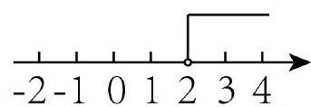
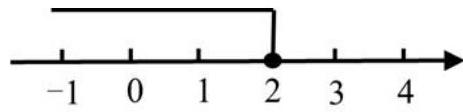

# AVP1082 — Single visual target

MV-MATH:347_4 / MV-MATH:345_2 · same type · Domain and solution-set constraints

## Shared or similar visual information

The direction of a marked trace on a number line or function graph. Compare the raised trace attached to the number-line mark at 2 in the left image with the raised trace attached to the number-line mark at 2 in the right image.

## Evidence locations

- Left image: The raised trace continuing right from the hollow dot at 2.
- Right image: The raised trace continuing left from the filled endpoint at 2.

## Mathematical meanings

Left image: The ray selects values above 2. Right image: The indicated ray selects the values below its boundary.

## Same mathematical meanings

no

## Rationales

The selected left cue selects values on the larger-input side of the boundary. The selected right cue selects values on the smaller-input side of the boundary, so the two constraints differ in how they admit values.

## Reasoning consequence

In the left image, reversing the direction would wrongly include 1 and omit 3. In the right image, taking the other direction would wrongly include 3 and exclude 1.

Only the selected target is annotated. AI visual-review draft; not independently double-annotated by humans.
