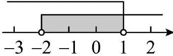
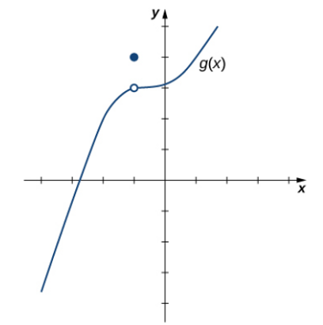

# AVP1083 — Single visual target

MV-MATH:343_3 / MathVista:37 · different type · Domain and solution-set constraints

## Shared or similar visual information

Circular markers at boundaries of marked spans or plotted branches. Compare the marker at 1 beside the gray region in the left image with the upper of the two vertically aligned markers in the right image.

## Evidence locations

- Left image: The hollow dot at 1 at the right side of the shaded region.
- Right image: The filled blue dot directly above the hollow dot on the curve.

## Mathematical meanings

Left image: The shaded overlap excludes the upper boundary 1. Right image: The filled dot gives the actual function value at that shared input.

## Same mathematical meanings

no

## Rationales

The selected left cue excludes the indicated boundary point. The selected right cue includes the indicated boundary point, so the two constraints differ in how they admit values.

## Reasoning consequence

In the left image, adding 1 would misreport the upper end of (−2, 1). In the right image, dropping the filled point would falsely leave the input without an assigned function value.

Only the selected target is annotated. AI visual-review draft; not independently double-annotated by humans.
