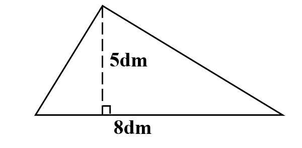

# AVP1086 — Single visual target

We-Math:225 / DynaMath:204 · different type · Geometric markers

## Shared or similar visual information

A vertical dashed line.

## Evidence locations

- Left image: The dashed line through the height label 5 dm.
- Right image: The vertical dashed segment from the right endpoint down to b.

## Mathematical meanings

Left image: The line represents the perpendicular altitude to the triangle base. Right image: The line projects the right endpoint of the curve onto horizontal coordinate b.

## Same mathematical meanings

no

## Rationales

In the left image, a vertical auxiliary segment marks a perpendicular height relative to a geometric base. In the right image, the vertical dashed segment projects a plotted position to its horizontal coordinate.

Only the selected target is annotated. AI visual-review draft; not independently double-annotated by humans.
